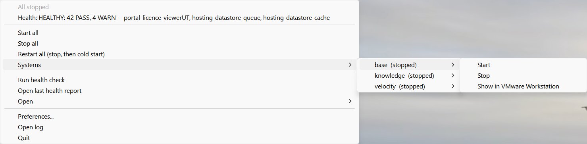

# StarterStopper

**One click to start, stop and health-check your home lab or sandbox, from the Windows system tray.**

StarterStopper starts your VMs and services in the right order, waits until each one genuinely works (not just
"powered on"), runs your own fix-up scripts, then runs a health check and tells you in one word whether the lab
is ready. It was built for ArcGIS Enterprise sandboxes, but the engine knows nothing about ArcGIS: anything you
can probe over HTTP or SSH can be managed.



> [!WARNING]
> **Projectware for sandboxes and home labs.** StarterStopper is a personal project, built and tested on one
> home lab (VMware Workstation on Windows 11, ArcGIS Enterprise 12.1 on Ubuntu guests). It is intended for
> sandbox, home-lab, demo and learning environments. It is **not** intended for production systems without
> considerably more rigorous testing in your own environment. It starts and stops machines and runs scripts
> you configure: review your configuration, keep backups and snapshots, and use it at your own risk. See the
> [licence](LICENSE): the software is provided "as is", without warranty of any kind.

## What it does

| | |
|---|---|
| **Ordered start and stop** | List order is start order; stop is the reverse. Graceful stop only, never a hard power-off. |
| **Real readiness** | Every system has probes (HTTP from your PC, or a command over SSH in the guest). All must stay green for a settle window before the next system starts. |
| **Hooks** | Run your own scripts before start, after boot, after ready, before and after stop. |
| **Health check, no AI needed** | Runs your check scripts, adds fix hints for known false alarms, and writes an HTML report. Ships with a profile-driven ArcGIS Enterprise REST probe. |
| **Guard rails** | RAM/vCPU ceiling across running VMs, Windows-hypervisor warning, pending-reboot notice, and safe handling of VMs suspended by host sleep. |
| **Quiet and light** | No console window, no admin rights for VMs, about 40 MB of memory, one status check a minute when idle. |
| **Configurable** | Everything is set in a Preferences window and saved outside the repository, so your hosts and paths never end up in git. |

Supported today: **VMware Workstation** VMs (via `vmrun`) and **Windows services** on the same PC.

## Quick start

Requirements: Windows 10 or 11, Python 3.9+ (python.org build), PowerShell 7 for the bundled health probe,
VMware Workstation for VM systems, and the Windows OpenSSH client if you use SSH probes.

```powershell
git clone <this repository URL>
cd starterstopper
.\install.ps1 -InstallDeps -Launch
```

Then right-click the tray icon, choose **Preferences...**, click **Load example**, edit it to match your lab,
and save.

**Full walkthrough with screenshots: [docs/USER_GUIDE.md](docs/USER_GUIDE.md).**

## Roadmap

Being considered, in no fixed order. Interest and help are welcome:

- **Proxmox VE** provider (start/stop/status through the Proxmox API).
- **Azure** and **AWS** providers, so cloud sandboxes can be started for a demo and stopped to save cost.
- Hyper-V provider.
- A packaged single-file `.exe`, so Python isn't required.
- More bundled health probes beyond ArcGIS Enterprise.

Each system type is a small provider class (`src/starterstopper/providers/`) with three methods (`states`,
`start`, `stop`), so a new platform is a contained piece of work.

## Contributing

Collaboration is welcome: bug reports, ideas, new providers, health probes or hint rules. See
[CONTRIBUTING.md](CONTRIBUTING.md). Please open an issue before a large change so we can agree on the approach.

## Licence and trademarks

[MIT](LICENSE). ArcGIS, ArcGIS Enterprise, ArcGIS Velocity and ArcGIS Knowledge are trademarks of Esri.
VMware Workstation is a trademark of Broadcom. StarterStopper is an independent project and is not affiliated
with, endorsed by or supported by Esri, Broadcom or any other vendor named here.
