# StarterStopper user guide

This guide walks you from installation to a lab that starts, checks itself and reports back with one click.
The screenshots come from a real ArcGIS Enterprise home lab with three VMware VMs (`base`, `knowledge`,
`velocity`); host names and addresses have been replaced with documentation values.

> StarterStopper is projectware for sandbox and home-lab environments. It is not intended for production use
> without much more rigorous testing. See the warning in the [README](../README.md).

**Contents**

1. [How it works](#1-how-it-works)
2. [Install](#2-install)
3. [First run](#3-first-run)
4. [Add your systems](#4-add-your-systems)
5. [Readiness probes](#5-readiness-probes)
6. [Hooks](#6-hooks)
7. [Health checks](#7-health-checks)
8. [General settings and links](#8-general-settings-and-links)
9. [Everyday use from the tray](#9-everyday-use-from-the-tray)
10. [Reading the health report](#10-reading-the-health-report)
11. [Host sleep and suspended VMs](#11-host-sleep-and-suspended-vms)
12. [Command line](#12-command-line)
13. [Troubleshooting](#13-troubleshooting)
14. [Configuration reference](#14-configuration-reference)
15. [Uninstall](#15-uninstall)

---

## 1. How it works

You describe your lab as an ordered list of **systems**. A system is a VMware VM or a set of Windows services.

When you click **Start all**, StarterStopper goes down the list. For each system it:

1. Checks it can start: the VMX exists, and starting it won't push running VMs past your RAM/vCPU ceiling.
2. Starts it, or resumes it, or cold-boots it if it was left suspended (see [section 11](#11-host-sleep-and-suspended-vms)).
3. Waits for SSH if any probe needs it, then runs your **afterBoot** hooks.
4. Waits until **every readiness probe passes and keeps passing for the settle time** (30 s by default). A single
   good response doesn't count: services that restart moments after first answering are a common trap.
5. Runs your **afterReady** hooks, then moves on to the next system.

If a system marked **critical** never becomes ready, the chain stops there, because everything after it depends
on it. A non-critical system that fails is marked degraded, and the rest still start.

Finally it runs your **health checks** and gives one verdict: **READY**, **DEGRADED** or **FAILED**, with an HTML
report. **Stop all** works through the list in reverse and only ever shuts machines down gracefully.

## 2. Install

You need:

- Windows 10 or 11.
- Python 3.9 or later from [python.org](https://www.python.org/downloads/windows/). The Microsoft Store stub is
  not enough.
- For VMware systems: VMware Workstation (StarterStopper finds `vmrun.exe` itself).
- For the bundled ArcGIS health probe: PowerShell 7 (`pwsh`).
- For SSH probes: the Windows OpenSSH client and a key that logs in to your guests without a password.

From a PowerShell prompt (no admin rights needed):

```powershell
git clone <this repository URL>
cd starterstopper
.\install.ps1 -InstallDeps -Launch
```

| Option | What it does |
|---|---|
| `-InstallDeps` | `pip install --user -r requirements.txt` (pystray and Pillow) |
| `-Launch` | Starts StarterStopper now |
| `-DesktopShortcut` | Also adds a desktop shortcut |
| `-NoStartup` | Doesn't add the Startup-folder shortcut |
| `-DryRun` | Prints what it would do and changes nothing |

The installer adds a shortcut to your Startup folder that runs `pythonw.exe StarterStopper.pyw`. `pythonw` has
no console, so nothing flashes up when you log in. A grey circle appears in the system tray; if you can't see
it, look under the **^** overflow arrow and drag it onto the taskbar.

## 3. First run

Right-click the tray icon and choose **Preferences...**. With no configuration yet, you'll see this:

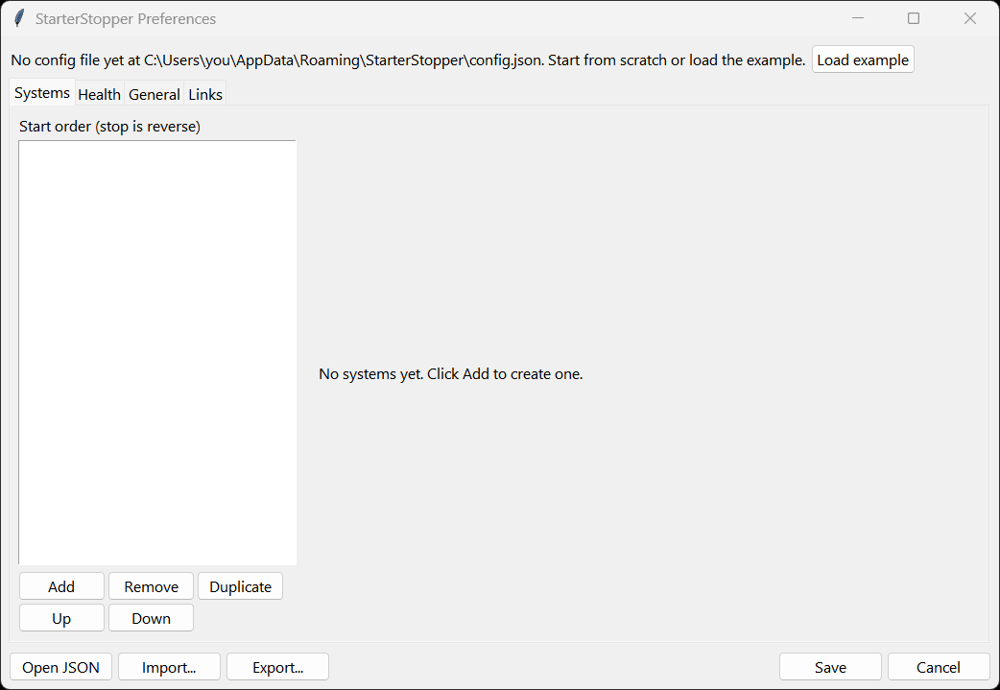

Click **Load example** to start from [`config.example.json`](../config.example.json), which describes a
three-VM ArcGIS lab and a disabled "ArcGIS on this PC" Windows-service system. Edit it to match your lab, then
click **Save**.

Your configuration is saved to `%APPDATA%\StarterStopper\config.json`, outside the repository. The tray app
notices the change and reloads it at its next status check (within a minute by default).

## 4. Add your systems

The **Systems** tab lists your systems in start order. Use **Add**, **Remove**, **Duplicate**, **Up** and
**Down** to manage the list. Stop runs in the reverse order, so put foundations (database, portal) at the top
and the things that depend on them below.

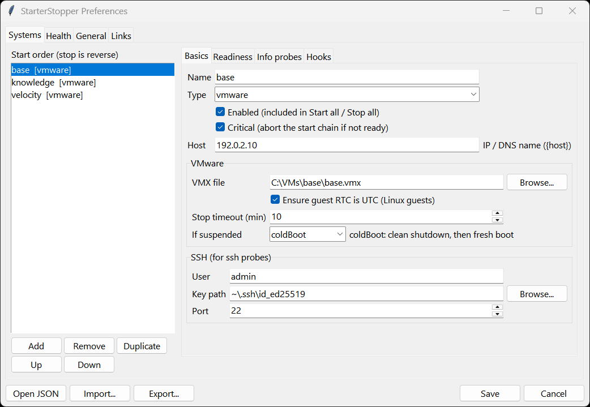

| Field | Meaning |
|---|---|
| Name | Shown in menus and logs. Must be unique. |
| Type | `vmware` for a VMware Workstation VM; `windows-service` for services on this PC. |
| Enabled | Included in **Start all** and **Stop all**. You can still start a disabled system on its own from the **Systems** submenu. |
| Critical | If this system doesn't become ready, don't start anything after it. |
| Host | IP address or DNS name. Probes use it as `{host}`, and so does SSH. |
| VMX file | The VM's `.vmx` file. |
| Ensure guest RTC is UTC | Sets `rtc.diffFromUTC = "0"` in the VMX while the VM is off. Linux guests expect a UTC hardware clock; without this they boot with the clock out by your time-zone offset until NTP corrects it. |
| Stop timeout | How long to wait for a graceful shutdown before giving up. StarterStopper never forces a power-off. |
| If suspended | `resume` (the VMware default) or `coldBoot`. See [section 11](#11-host-sleep-and-suspended-vms). |
| SSH user / key / port | Used by SSH probes. Key-based login only; StarterStopper never asks for or stores a password. |

For a **windows-service** system, list the service names (the internal names, as shown by `Get-Service`), one per
line, in start order. Reading service status needs no admin rights. Starting or stopping them shows one UAC
prompt per action.

## 5. Readiness probes

The **Readiness** tab decides when a system counts as up.

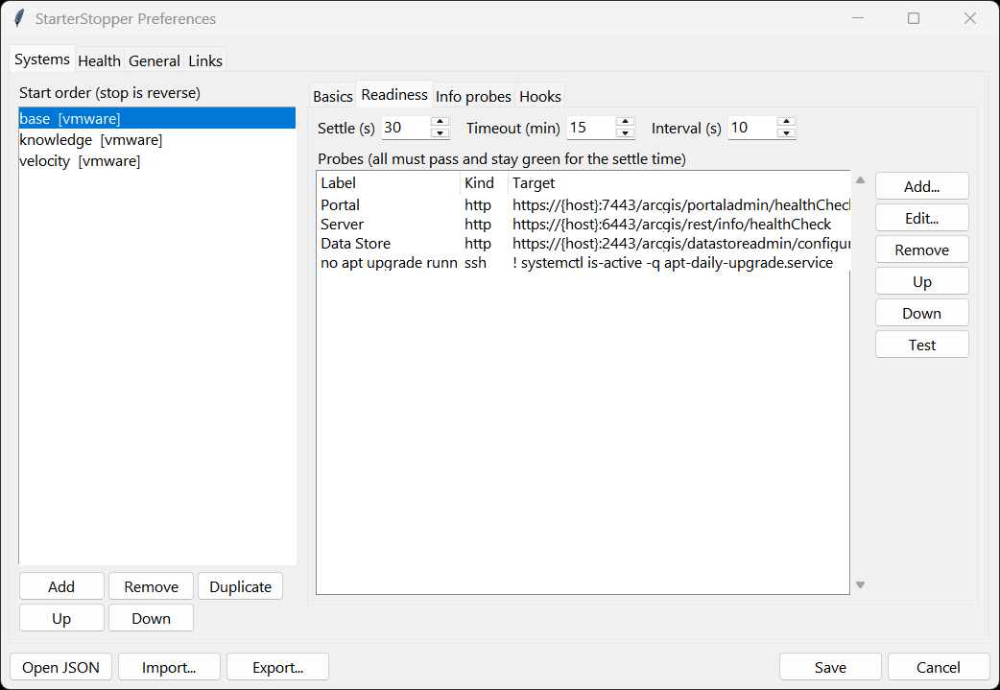

- **Settle (s)**: how long every probe must keep passing before the system counts as ready.
- **Timeout (min)**: give up after this long.
- **Interval (s)**: time between probe rounds.

Click **Add...** or **Edit...** to open the probe editor:

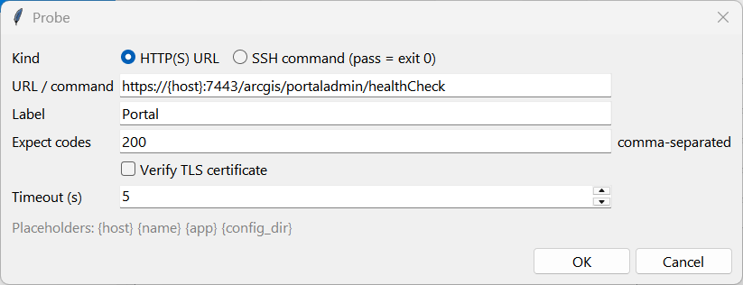

There are two kinds of probe:

| Kind | Passes when | Example |
|---|---|---|
| HTTP(S) URL | The response status is one of the expected codes (default `200`). Runs from your PC. Certificates are not verified unless you tick **Verify TLS certificate**, because labs often use self-signed certificates. | `https://{host}:7443/arcgis/portaladmin/healthCheck` |
| SSH command | The command exits with 0. Runs inside the guest. | `! systemctl is-active -q apt-daily-upgrade.service` (passes when no OS upgrade is running) |

Select a probe and click **Test** to run it once against the current form values.

The **Info probes** tab takes the same kind of probes, but a failing info probe is only reported and never
blocks a start. The example uses `test ! -f /var/run/reboot-required` to tell you when a guest needs a reboot to
finish installing updates.

Good readiness probes for ArcGIS Enterprise:

| Component | Probe |
|---|---|
| Portal for ArcGIS | `https://{host}:7443/arcgis/portaladmin/healthCheck` |
| ArcGIS Server | `https://{host}:6443/arcgis/rest/info/healthCheck` |
| ArcGIS Data Store | `https://{host}:2443/arcgis/datastoreadmin/configure` |
| ArcGIS Velocity | `https://{host}:7143/arcgis/rest/info` |

## 6. Hooks

Hooks are commands StarterStopper runs at fixed points. Use them for the fix-ups your lab needs every time.

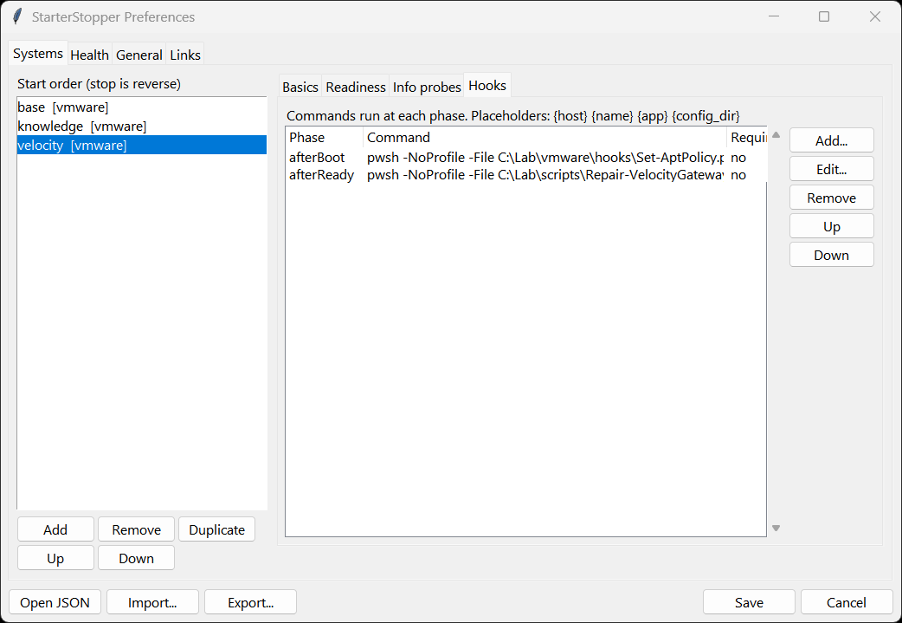

| Phase | When it runs |
|---|---|
| `beforeStart` | Before the system is started (skipped if it is already running) |
| `afterBoot` | Once it is up (and SSH answers, if it has SSH probes), before the readiness wait |
| `afterReady` | After readiness has held for the settle time |
| `beforeStop` / `afterStop` | Around a graceful stop |

Each hook has:

- **Required**: if ticked, a failure counts as a failed system; otherwise it is a warning.
- **Timeout**: how long the hook may run.

Hooks run hidden, and their output goes to the log. They receive these environment variables:

- `SS_SYSTEM`
- `SS_HOST`
- `SS_PHASE`
- `SS_VMX`

Hooks run on every start, including when the system was already running, so **write them to be idempotent**:
safe to run twice, and quick when there's nothing to do. The example above uses an `afterBoot` hook to
enforce an OS-patching policy, and an `afterReady` hook that checks and repairs a message broker.

## 7. Health checks

The **Health** tab lists the checks to run after **Start all** (if **Run health checks after Start all** is
ticked) and whenever you choose **Run health check** from the tray.

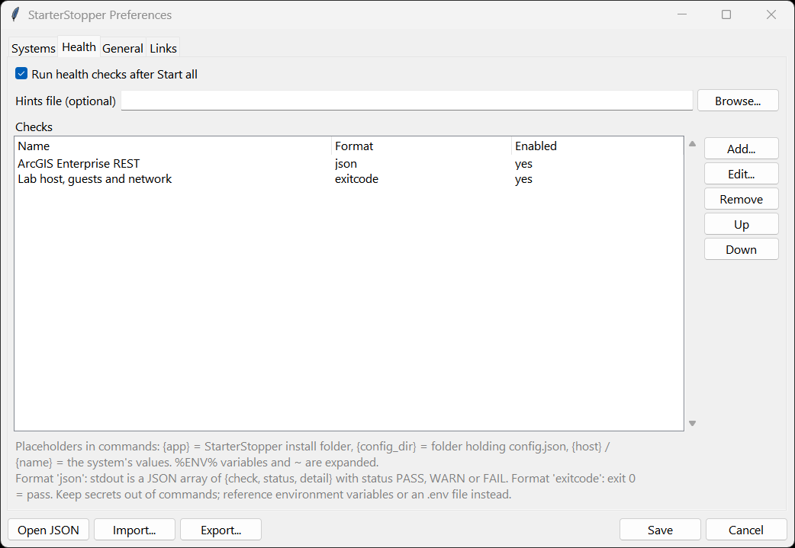

A check is any command. Choose a format:

| Format | Meaning |
|---|---|
| `json` | The command prints a JSON list of `{"check": ..., "status": "PASS" / "WARN" / "FAIL", "detail": ...}` rows (a wrapper object with a `results` list also works). Each row is shown in the report. |
| `exitcode` | Exit code 0 is a pass; anything else is a fail, with the last few output lines as the detail. |

**The bundled ArcGIS Enterprise probe.** `health/Test-ArcGISEnterprise.ps1` checks the following:

- Portal health and licences.
- Federation.
- Each server's health, machines, licences, stopped services and SEVERE logs.
- Each managed data store.
- Velocity feeds and analytics.
- Optional layer queries.
- Certificate expiry and trust.

It reads a JSON profile. To set it up:

1. Copy `health/profiles/example.json` to `%APPDATA%\StarterStopper\health-profile.json` and edit the URLs.
2. Provide credentials as **environment-variable names**, either from your environment or an `.env` file named in
   the profile. Never put a password in the profile or in StarterStopper's config.
3. Add the check with the command
   `pwsh -NoProfile -File "{app}\health\Test-ArcGISEnterprise.ps1" -Profile "{config_dir}\health-profile.json" -Json`
   and format `json`.

See [health/README.md](../health/README.md) for the profile fields.

**Hints.** StarterStopper adds a hint to WARN and FAIL rows that match a list of known false alarms and common
causes (`src/starterstopper/hints.json`). To add your own, point **Hints file** at a JSON file in the same
format. Your hints are checked first.

## 8. General settings and links

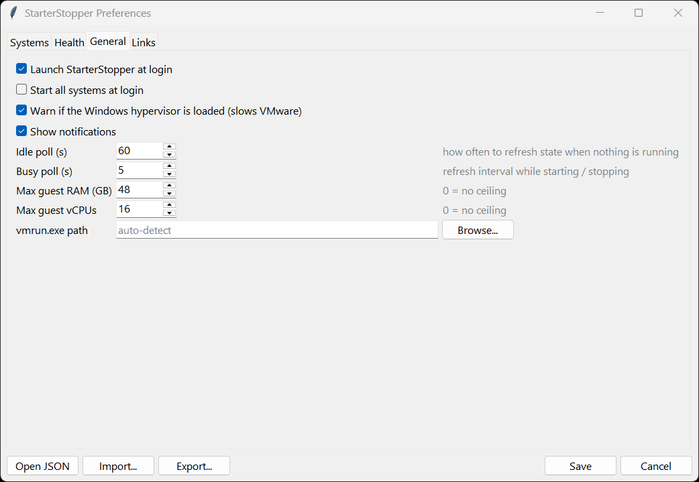

| Setting | Meaning |
|---|---|
| Launch StarterStopper at login | Keeps the Startup-folder shortcut in place (or removes it). |
| Start all systems at login | Runs **Start all** automatically, but only within 15 minutes of Windows starting, so restarting the app later doesn't start your lab. |
| Warn if the Windows hypervisor is loaded | VMware Workstation runs much more slowly when Hyper-V / Virtualization-Based Security is active. Windows updates can switch it back on silently. |
| Idle / busy poll | How often status is refreshed when idle (default 60 s) and while an operation runs (5 s). |
| Max guest RAM / vCPUs | Refuse to start a VM if running VMs would exceed this. 0 means no ceiling. |
| vmrun.exe path | Leave blank to auto-detect. |

The **Links** tab adds shortcuts to the tray's **Open** submenu, for example Portal and Velocity.

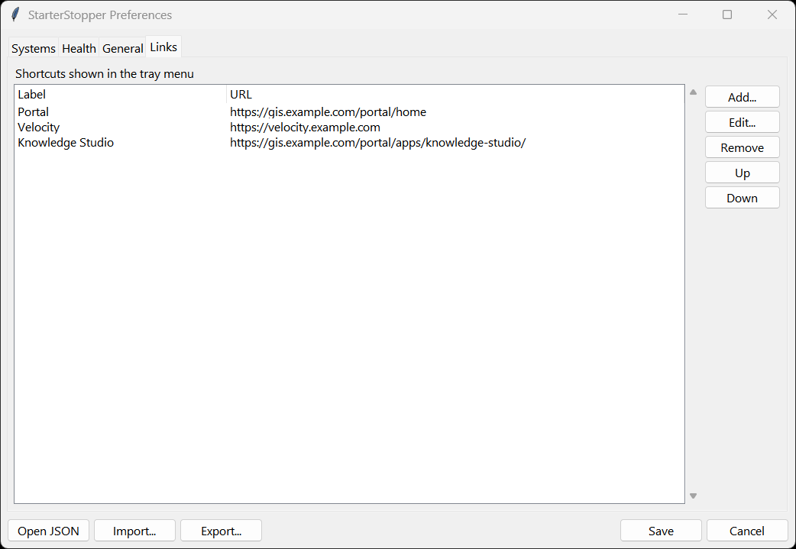

## 9. Everyday use from the tray

The icon colour shows the state of the systems included in **Start all**:


| Colour | Meaning |
|---|---|
| Green | All running, and the last start and health check were clean |
| Amber | Degraded (see the health report), or only some systems running |
| Red | All stopped |
| Yellow | Starting, stopping or checking; hover for the current step |
| Grey | Unknown, or nothing configured |
| Badge | Configuration error, or the Windows hypervisor is loaded |

Right-click for the menu:

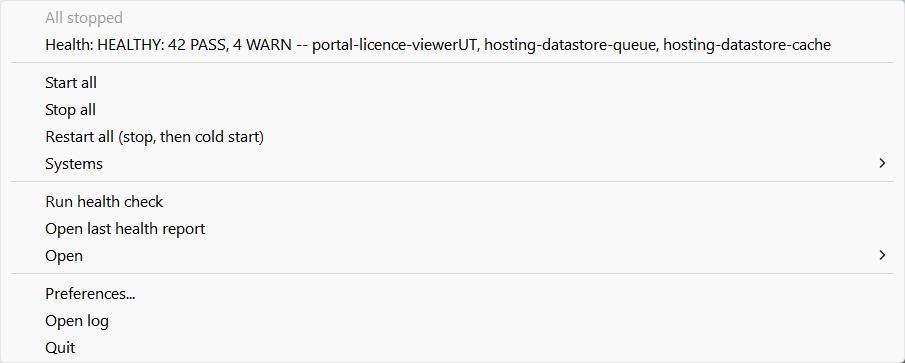

- The first line is the current state; the second is the last health result (click it to open the report).
- **Start all**, **Stop all** and **Restart all** act on every enabled system, in order. Restart is a full
  graceful stop followed by a cold start.
- **Cancel** appears while something is running. It stops waiting; it never powers anything off.
- **Systems** lets you start or stop one system, or open a VM in the VMware Workstation window (VMs started
  with `vmrun` don't appear in Workstation's library on their own):

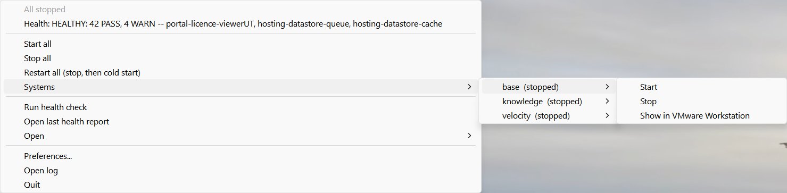

- **Run health check** runs the health checks without starting anything.
- **Open log** shows the log file, `%LOCALAPPDATA%\StarterStopper\logs\starterstopper.log`, which records every step.

You'll also get a Windows notification when a start, stop or health check finishes. You can turn notifications
off in General.

## 10. Reading the health report

Reports are saved in `%LOCALAPPDATA%\StarterStopper\reports\`; `last.html` is always the newest. Failures come
first, then warnings, each with its hint. Passed checks are collapsed at the bottom.

A healthy lab, with warnings that are known and harmless:

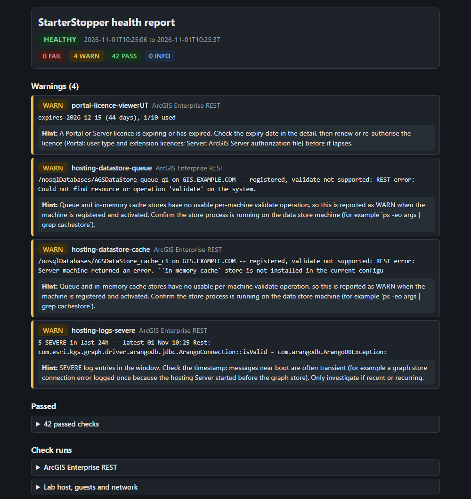

A real failure, captured the morning after the lab PC had been put to sleep with the VMs running. The hint
points straight at the cause, which [section 11](#11-host-sleep-and-suspended-vms) explains:

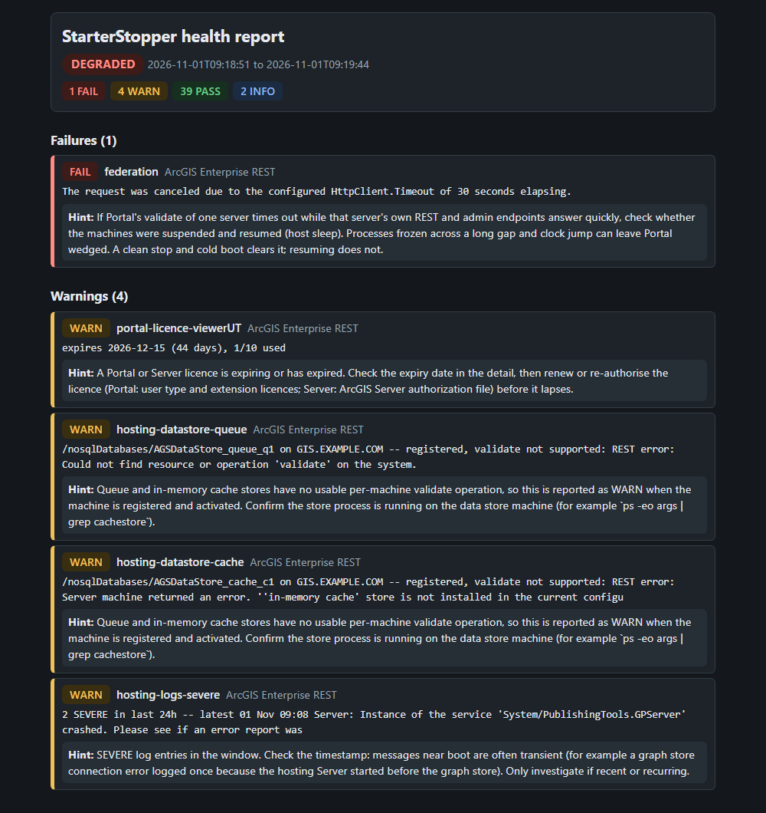

## 11. Host sleep and suspended VMs

If you put your PC to sleep while VMs are running, VMware suspends them. Starting them again *resumes* them:
every process inside carries on from where it froze, hours later, with the clock suddenly jumped forward. Many
server products cope badly with that. In the lab used for these screenshots, Portal for ArcGIS hung when
validating its hosting server, while everything else looked fine. A clean shutdown and fresh boot fixed it;
resuming did not.

StarterStopper helps in three ways:

- The tray shows how many VMs are suspended and raises a notification when it finds them.
- Setting **If suspended** to **coldBoot** makes **Start** resume the VM, shut it down cleanly, then boot it
  fresh, all automatically.
- **Restart all** does a full graceful stop and cold start whenever you want a clean slate.

Better still, **Stop all** before you sleep or shut down the PC. A sudden power loss is worse than a suspend: it
can corrupt databases and message logs inside the guests.

## 12. Command line

The same engine runs from a console, which is handy for scheduled tasks or scripts:

```powershell
python StarterStopper.pyw --cli status
python StarterStopper.pyw --cli start              # all enabled systems, then health checks
python StarterStopper.pyw --cli start base         # just one system (no health check)
python StarterStopper.pyw --cli stop
python StarterStopper.pyw --cli health
```

The exit code is 0 for READY / STOPPED / HEALTHY and 1 otherwise.

## 13. Troubleshooting

| Symptom | What to check |
|---|---|
| No tray icon | Look under the **^** overflow. Check the Startup shortcut exists (`shell:startup`). Run `python StarterStopper.pyw --cli status` to see errors in a console. |
| "StarterStopper is already running" | Only one tray instance runs at a time; find the existing icon. |
| Badge on the icon, "Config error" in the menu | The menu line shows the error and which field is wrong; click it to open Preferences. The version last saved from Preferences is kept as `config.json.bak`. |
| System never becomes ready | Open the log: every probe result is recorded when it changes. Use **Test** in the probe editor. Check firewalls allow the probe port from your PC. |
| SSH probes fail | Test from a console: `ssh -i <key> user@host true` must succeed without a prompt. StarterStopper uses the Windows OpenSSH client. |
| "Starting it would take running VMs to ..." | The RAM/vCPU ceiling in General. Stop something or raise the limit. |
| Hypervisor warning | Hyper-V, Windows Sandbox, WSL2, or Memory Integrity (Core Isolation) has turned on the Windows hypervisor. Turn them off if you want full VMware performance. |
| A VM won't stop | StarterStopper waits for a graceful shutdown and never forces it. Check VMware Tools is running in the guest, then shut it down from inside the guest. |
| Windows-service start/stop does nothing | Accept the UAC prompt; the operation needs administrator rights. |

## 14. Configuration reference

`%APPDATA%\StarterStopper\config.json`. Preferences writes it for you; this is for anyone who prefers to edit the
file directly.

| Section | Fields |
|---|---|
| `general` | `launchAtLogin`, `startAllAtLogin`, `idlePollSeconds`, `busyPollSeconds`, `maxGuestGB`, `maxVcpu`, `vmrunPath`, `checkHypervisor`, `notifications` |
| `systems[]` | `name`, `type` (`vmware` / `windows-service`), `enabled`, `critical`, `host`, `vmx`, `ensureUtcRtc`, `onSuspended` (`resume` / `coldBoot`), `stopTimeoutMinutes`, `services[]`, `ssh` {`user`, `keyPath`, `port`}, `ready` {`settleSeconds`, `timeoutMinutes`, `intervalSeconds`, `probes[]`}, `infoProbes[]`, `hooks` {phase: [{`cmd`, `required`, `timeoutMinutes`}]} |
| probe | `http` or `ssh` (exactly one), `label`, `expect[]`, `verifyTls`, `timeoutSeconds` |
| `health` | `runAfterStart`, `hintsFile`, `checks[]` {`name`, `cmd`, `format` (`json` / `exitcode`), `timeoutMinutes`, `enabled`} |
| `links[]` | `label`, `url` |

You can use these placeholders in commands, URLs and paths:

- `{host}` and `{name}`: the system's values.
- `{app}`: the StarterStopper folder.
- `{config_dir}`: the folder that holds `config.json`.

`%ENV%` variables and a leading `~` are also expanded.

## 15. Uninstall

```powershell
.\uninstall.ps1              # removes shortcuts, stops the app, keeps your config and reports
.\uninstall.ps1 -RemoveData  # also deletes %APPDATA%\StarterStopper and %LOCALAPPDATA%\StarterStopper
```
